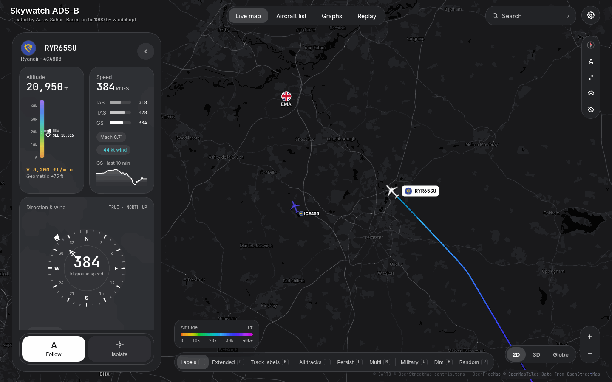
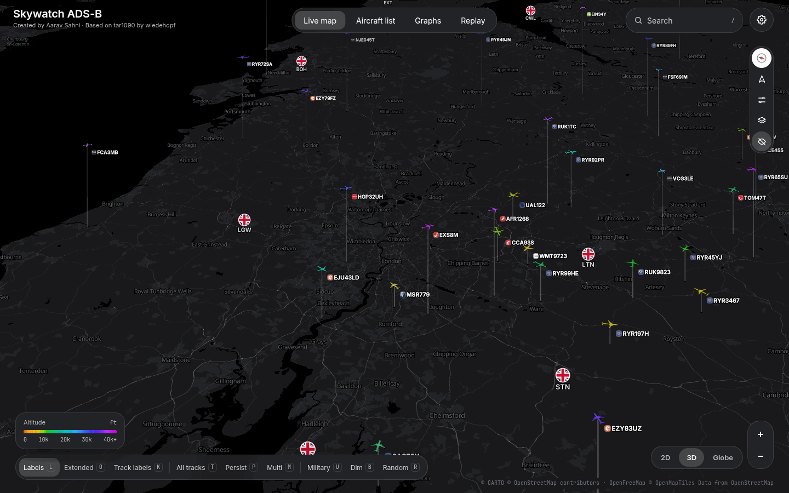
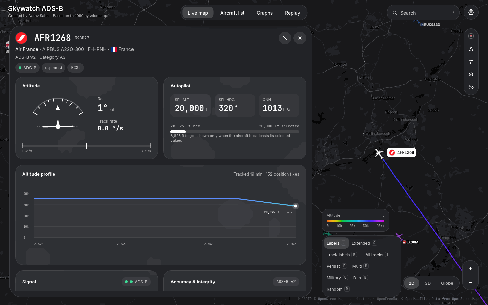
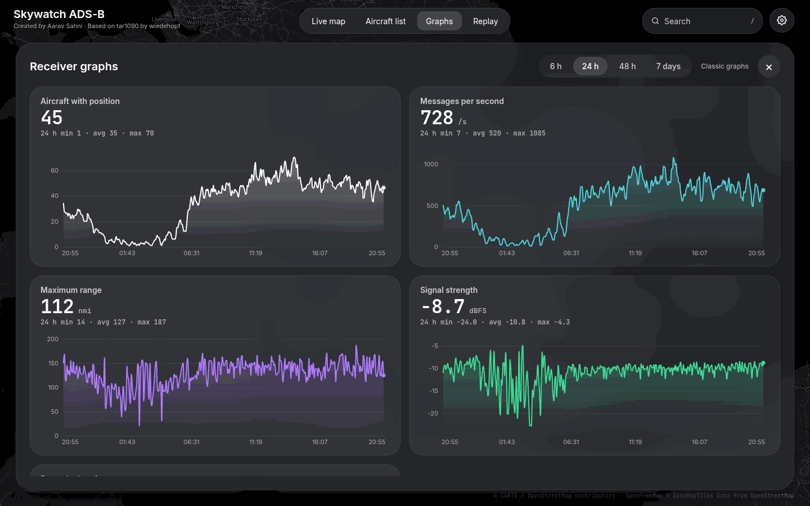
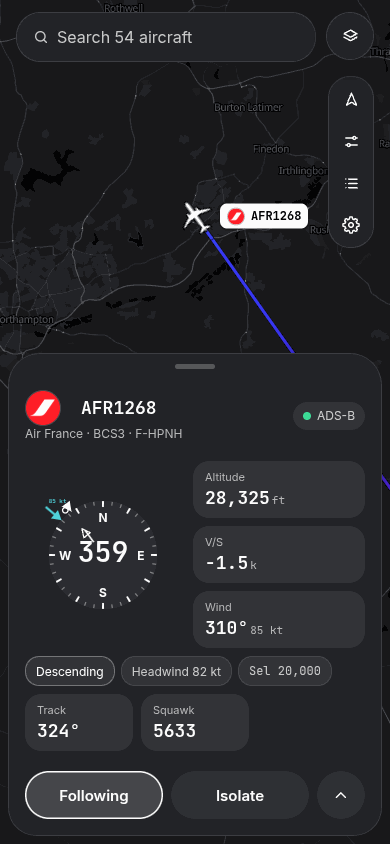
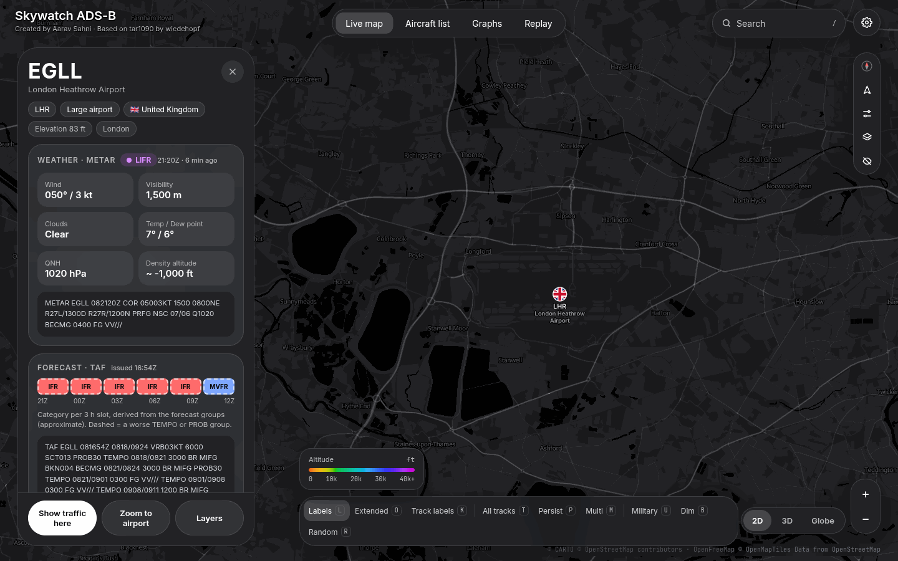

# Skywatch ADS-B

A modern, map-first web interface for your own ADS-B receiver: a fork of [tar1090](https://github.com/wiedehopf/tar1090).

> **Credit:** Skywatch ADS-B is built on [tar1090 by wiedehopf](https://github.com/wiedehopf/tar1090). The decoder
> integration, history, traces and data handling are wiedehopf's and the tar1090 contributors' work, and the upstream
> licence (GPL v2 or later) is kept. Created by Aarav Sahni.



| | |
|---|---|
|  |  |
|  |  |
|  | |

*Screenshots are from the author's live receiver. They show commercial airliners only and no receiver position.*

## Features

- Floating glass interface: aircraft list with filter chips and search, settings, phone layout.
- MapLibre GL JS map in 2D, 3D (altitude lift) and Globe.
- Selecting an aircraft zooms to its flight path and follows it; tracks use an altitude colour gradient.
- Instrument panel for the selected aircraft: altitude and speed gauges, direction and wind compass, attitude and autopilot cards (when the aircraft broadcasts them), altitude profile.
- Airport detail overlay at high zoom (aprons, taxiways, runways, stands) from OpenStreetMap data.
- Airport panel: click an airport (or search an ICAO or IATA code, or a name) for METAR and TAF with flight category, runways with wind components and the best end, local traffic, frequencies, sun times and links. Weather needs the recorder (below).
- Replay bar to scrub through the receiver history.
- Live receiver graphs (aircraft, messages, range, signal, polar) drawn in the browser, with a link to the classic graphs1090 images.
- Smooth aircraft movement (dead reckoning between position updates; the table and tracks use real positions).

## Works with

Anything that produces the tar1090 data format: [readsb](https://github.com/wiedehopf/readsb),
[ultrafeeder](https://github.com/sdr-enthusiasts/docker-adsb-ultrafeeder), dump1090-fa. Developed and tested
against ultrafeeder (readsb 3.16).

## Install with ultrafeeder

1. Clone this repository on the host running ultrafeeder.
2. Mount it read-only and enable updates (placeholder paths):

   ```yaml
   services:
     ultrafeeder:
       image: ghcr.io/sdr-enthusiasts/docker-adsb-ultrafeeder
       volumes:
         - /path/to/skywatch-adsb:/var/tar1090_git_source:ro
       environment:
         - UPDATE_TAR1090=true
   ```
   Keep the rest of your ultrafeeder configuration (decoder, location, feeders) as it is.
3. Recreate the container: `docker compose up -d`.
4. Hard-refresh the browser (Ctrl+Shift+R).

To deploy later changes without recreating the container run `scripts/deploy-local.sh`
(variables `CONTAINER`, default `ultrafeeder`, and `SITE_URL`, default `http://127.0.0.1:8096`).

## Standalone install

The upstream `install.sh` is still in the repository and installs the web files next to readsb or dump1090-fa
(see [README-tar1090.md](README-tar1090.md)). **This path has not been tested for this fork**; the author runs it only
under ultrafeeder.

## Configuration

All tar1090 options still apply (`html/defaults.js`, `html/config.js`, or `TAR1090_*` variables in ultrafeeder).
Options added or changed by this fork:

| Option | Default | Meaning |
|---|---|---|
| `PROJECT_NAME`, `PROJECT_SHORT`, `PROJECT_CREDIT` (`html/project.js`) | Skywatch ADS-B ... | Name and credit line shown in the UI, page title and manifest. |
| `airlineLogos` | `true` | Airline logos (sends airline codes to the logo host). |
| `airlineLogoUrl` | `https://pics.avs.io/al_square/{size}/{size}/{iata}.png` | Logo source. `{iata}` and `{size}` are replaced. |
| `airlineLogoKey` | empty | Key for the logo service if it needs one. Never commit a key. |
| `airportDetail` | `true` | Airport detail overlay (OpenFreeMap tiles). |
| `terrain3d` | `false` in `defaults.js`; the first-run default is on for desktop with a hardware GPU | Real terrain in the 3D view (elevation tiles from AWS Open Data). Settings has an exaggeration slider. |
| `planespottersAPI` | `true` | Aircraft photos from planespotters.net. |
| `useRouteAPI`, `routeApiUrl` | `false`, adsb.im | Route lookup. Off by default; set `routeApiUrl = ""` to forbid it. |
| `airportWeather`, `airportLinks` | `true` | Weather cards and external link buttons in the airport panel. |
| `SiteShow`, `actual_range_show` | `false` | Show the receiver marker and range outline. |

The receiver position drives the distance column, bearings and the instrument panel's receiver distance only when
`SiteShow` is on. Per-visitor settings (base map, map view, smooth movement and the switches above) are in Settings
and stored in the browser.

## Graphs recorder (optional)

`scripts/skywatch-recorder.py` (Python standard library only) samples the receiver once a minute and writes
`history.json` and `polar.json` under `globe_history/skywatch/`. **It stores only counts, message rate, maximum range,
average signal level and per-hour bearing and distance bins. It stores no coordinates, hex codes or callsigns.**
Run it as a second compose service using the ultrafeeder image:

```yaml
  skywatch-recorder:
    image: ghcr.io/sdr-enthusiasts/docker-adsb-ultrafeeder
    restart: unless-stopped
    depends_on: [ultrafeeder]
    entrypoint: ["python3", "-u", "/opt/skywatch/skywatch-recorder.py"]
    environment:
      - SW_SRC=http://ultrafeeder/data
      - SW_OUT=/var/globe_history/skywatch
    volumes:
      - /path/to/skywatch-adsb/scripts/skywatch-recorder.py:/opt/skywatch/skywatch-recorder.py:ro
      - ./globe_history:/var/globe_history
      - ./graphs1090:/var/lib/collectd:ro   # optional: seeds the first week from graphs1090 data
```

Other variables: `SW_INTERVAL`, `SW_KEEP_DAYS`, `SW_RRD`. Without the recorder the Graphs view shows the classic
graphs1090 images, or says nothing is available. The polar plot reveals the bearing and range pattern around your
receiver, so only publish it if that is acceptable.

### Weather for the airport panel

The same recorder also fetches METAR and TAF from [aviationweather.gov](https://aviationweather.gov/data/api/) every
5 minutes (one request each, for a bounding box of whole degrees about 3 degrees around your receiver, taken from
`receiver.json`; override with `SW_WX_BOX=lat0,lon0,lat1,lon1`) and writes `wx.json` next to `history.json`. Browsers
cannot call that API themselves because it sends no CORS headers. `wx.json` holds the weather reports (raw and decoded)
for stations in that area and no coordinates. Set `SW_WX=0` to turn the fetch off. Without `wx.json` (or when it is more
than 3 hours old) the airport panel simply has no weather cards.

## Data sources and privacy

Visitors' browsers contact these services directly, and each sees the visitor's IP address and what is requested:

| Service | For | Can be turned off |
|---|---|---|
| OpenFreeMap / VersaTiles / CARTO | map tiles and styles | choose the base map; there is no map without tiles |
| AWS Open Data (s3.amazonaws.com) | elevation tiles, only in the 3D view with terrain on | yes (`terrain3d`, Settings) |
| pics.avs.io | airline logos | yes (`airlineLogos`) |
| planespotters.net | aircraft photos | yes (`planespottersAPI`) |
| adsb.im | flight routes | off by default (`useRouteAPI`) |
| aviationweather.gov | METAR and TAF, fetched by the recorder on your server, not by browsers | `SW_WX=0`, or `airportWeather = false` hides the cards |
| SkyVector, NATS AIP, Wikipedia | only when a visitor clicks a link in the airport panel | `airportLinks = false` |

Airport data (`html/airport-db/airports.json`) comes from [OurAirports](https://ourairports.com/data/) (public domain) and is
built by `tools/build-airports.py`; it has no ILS data, so none is shown.

Licences, terms found for each service and doubtful cases are in [THIRD_PARTY.md](THIRD_PARTY.md), including a
suggested Content Security Policy. If you publish your site, `aircraft.json` and `receiver.json` are served to
everyone, and `receiver.json` contains the receiver position unless your decoder is configured to hide it.

## Running this publicly

- **Map tiles:** the default is OpenFreeMap (a free public service, donation funded, no SLA) through our own style
  file. If it fails the map switches to VersaTiles (rate-limited per IP, no guarantee) and shows a banner. CARTO is
  opt-in only (its terms need an API key and limit free use). No OpenStreetMap standard tiles are used. For a busy
  public site, host your own tiles (next section).

### Self-hosting your own tiles

Public tile servers are shared and can rate-limit you. When your site has regular visitors, or you need it to keep
working through a provider outage, serve tiles yourself:

1. OpenFreeMap publishes self-hosting instructions and images (https://github.com/hyperknot/openfreemap); it needs a
   server with a lot of disk (the planet is hundreds of GB) and is meant for people who want a whole-world map.
2. For one region, create a PMTiles extract with the `pmtiles` CLI from a planet build and serve the single file
   from any static host that supports HTTP range requests.
3. Copy `html/styles/skywatch-dark.json` and change the `openmaptiles` source URL, `glyphs` and `sprite` to your
   server, then set `MapType_tar1090` to that layer. This was not tested here; treat it as a starting point.

- **Visitor privacy:** every viewer's browser contacts the services in the table above directly, so those services see
  the viewer's IP address. Switch off the logos, photos and route lookup if that is not acceptable
  (see `airlineLogos`, `planespottersAPI`, `useRouteAPI`).
- **Receiver position:** `receiver.json` and `aircraft.json` are public if your site is. Keep `SiteShow` off and
  configure your decoder accordingly if you do not want your location known.
- A starting Content Security Policy is in [THIRD_PARTY.md](THIRD_PARTY.md).

## Browser support

Tested only with headless Chromium (desktop 1440x900 and a 390x844 phone viewport). Other browsers are expected to
work because MapLibre needs WebGL (WebGL2 for Globe) but have not been tested.

## Keeping up with upstream

The history contains tar1090's own commits, so upstream can be merged:

```
git remote add upstream https://github.com/wiedehopf/tar1090.git
git fetch upstream && git merge upstream/master
```

Expect conflicts in `html/index.html`, `html/script.js` and `html/style.css`, which this fork changed heavily.

## Known limitations

- Airport detail depends on OpenStreetMap quality (stands, taxiway letters and runway numbers can be missing).
- The dashed route line has not been checked with a real looked-up route.
- Phone layout of the replay bar and touch scrubbing have not been tried on a real device.
- The polar plot has only been seen with a few days of data.
- Airport panel: runway-in-use is inferred from a few minutes of traffic and can be wrong; the TAF strip is an approximation; the UK AIP link goes to the NATS AIP page, not to the airport's own page; the airport search only knows airports with an ICAO or IATA code (plus larger fields).
- The standalone `install.sh` path is untested.
- Only Chromium has been tested.
- The aircraft icons are the stock tar1090 shapes; there is no custom icon set yet.

## Contributing

See [CONTRIBUTING.md](CONTRIBUTING.md). Security issues: [SECURITY.md](SECURITY.md). Changes: [CHANGELOG.md](CHANGELOG.md);
development notes: [docs/DEVELOPMENT.md](docs/DEVELOPMENT.md).

## Licence

GNU GPL v2 or later, as tar1090 (see [LICENSE](LICENSE), identical to upstream).

## Credits

- [wiedehopf](https://github.com/wiedehopf) and the tar1090 contributors.
- MapLibre GL JS, OpenFreeMap, VersaTiles, CARTO, OpenStreetMap contributors, Inter, JetBrains Mono, planespotters.net,
  Wikidata: see [THIRD_PARTY.md](THIRD_PARTY.md).
